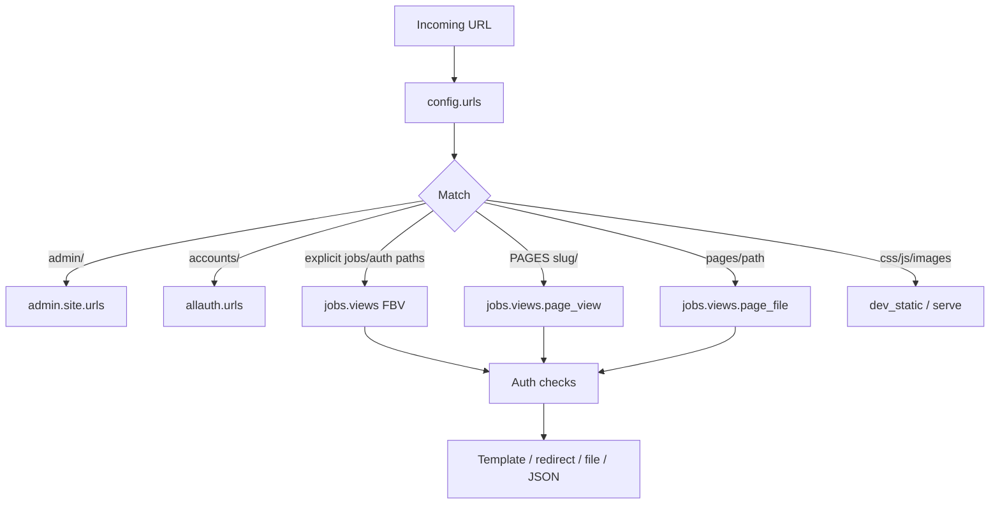

# TalentBridgeAI — Day 6 Complete Django URL Map

**Date:** 2026-11-18  
**Roadmap day:** Day 6 only  
**Status:** COMPLETE  
**Constraint honored:** No URL renames, no view/auth rewrites, no migrations, no DB writes, no package installs. Mapping and safe verification only.

**Machine inventory artifact:** `docs/reports/_day6_url_inventory.json`  
**Generator (read-only helper):** `tools/_day6_url_inventory.py`

---

## 1. Project and Django identification

| Item | Value |
| --- | --- |
| Project root | `E:\Job POrtal\TalentBridgeAI` |
| Django project | `backend\legacy-django` |
| Settings module | `config.settings` |
| Root URLconf | `config.urls` → `backend\legacy-django\config\urls.py` |
| App-level `jobs/urls.py` | **Does not exist** |
| REST framework / API routers | **Not present** |
| Handler | `handler403 = jobs.views.access_denied_view`; **no** `handler404` / `handler500` |

---

## 2. URL configuration files inspected

| File | Role |
| --- | --- |
| `backend/legacy-django/config/urls.py` | **Sole project URLconf** — explicit routes, `PAGES` slug map, static catch-alls |
| `django.contrib.admin` via `admin.site.urls` | Included at `admin/` |
| `allauth.urls` via `path('accounts/', include('allauth.urls'))` | Account + socialaccount + Google provider routes |
| `jobs/views.py`, `jobs/dev_preview_views.py` | View implementations |
| Frontend templates under `frontend/pages/` | Targets for `page_view` / `page_file` |

No other project-owned `urls.py` modules are included by the root configuration.

---

## 3. Route-flow overview (confirmed)

```text
HTTP request
  → Django URL resolver (config.urls)
      → Explicit path()/re_path() match (first match wins)
      → OR include(admin.site.urls) / include(allauth.urls)
      → View (FBV / CBV / RedirectView / serve / page_view / page_file)
          → Decorators / body role checks / ownership checks
          → Template render | JSON | FileResponse | redirect | 403/404/405
```



**First-match vs last-name:** Patterns are matched in registration order. Named `reverse()` uses the **last** registration for a given name. Several slug routes in `PAGES` **re-register** names already used by earlier explicit views (see §11).

---

## 4. Route counts (resolver inventory)

| Bucket | Count | Notes |
| --- | ---: | --- |
| **Total registered patterns** | **257** | Full resolver walk |
| Django admin (`admin/…`) | 119 | Auto-generated admin CRUD |
| `page_view` / `page_file` | 51 | Slug pages + nested `/pages/…` |
| `jobs` app views (explicit) | 39 | Core portal FBVs |
| allauth (`accounts/…`) | 29 | Login/signup/password/social/Google |
| Redirect aliases | 8 | Day-2 friendly aliases |
| Password reset (contrib auth) | 4 | Project templates |
| Dev preview | 2 | `__dev__/` |
| Assets / other | ~5 | favicon, index.html, css/js/images catch-alls |
| Non-admin application-relevant | **138** | Listed in inventory JSON |

---

## 5. Complete route mapping tables

Legend for **Authentication / Role** columns:

- **A** Public  
- **B** Authenticated (`@login_required` or equivalent)  
- **C** Candidate-oriented (role checks in view / dashboard)  
- **D** Employer-oriented (company owner checks)  
- **E** Staff/admin (`is_staff` / Django admin)  
- **F** Object ownership (e.g. job company owner, resume of applicant)  
- **H** Unclear / delegated through `page_view`/`page_file`  

Legend for **Working Status**: evidence-based only.

### 5.1 Public website & marketing (`page_view` + related)

| # | URL Pattern | URL Name | URLconf | View | Template / Response | Auth | Permissions / Role | Working Status |
| --- | --- | --- | --- | --- | --- | --- | --- | --- |
| 1 | `/` | `home` | `config/urls.py` | `jobs.views.home` | `frontend/index.html` | A | Public | **VERIFIED WORKING** (GET 200) |
| 2 | `/signup/` | `signup` | `config/urls.py` | `page_view` | `signup-role.html` | A | Public | **VERIFIED WORKING** (200) |
| 3 | `/employer/` | `employer` | same | `page_view` | `employer.html` | A | Public | **VERIFIED WORKING** (200) |
| 4 | `/jobseaker/` | `jobseaker` | same | `page_view` | `jobseaker.html` | A | Public | **VERIFIED WORKING** (200) |
| 5 | `/employee/` | `employee` | same | `page_view` | `employee.html` | A | Public | **PARTIALLY VERIFIED** (template exists; no smoke this run) |
| 6 | `/pricing/` | `pricing` | same | `page_view` | `pricing.html` | A | Public | **VERIFIED WORKING** (200) |
| 7 | `/about/` | `about` | same | `page_view` | `about.html` | A | Public | **VERIFIED WORKING** (200) |
| 8 | `/contact/` | `contact` | same | `page_view` → may delegate | `contact.html` / `contact_page` | A | Public | **VERIFIED WORKING** (200) |
| 9 | `/faq/` | `faq` | same | `page_view` | `faq.html` | A | Public | **VERIFIED WORKING** (200) |
| 10 | `/help/` | `help` | same | `page_view` | `help.html` | A | Public | **PARTIALLY VERIFIED** (registered; template exists) |
| 11 | `/blog/` | `blog` | same | `page_view` | `blog.html` | A | Public | **PARTIALLY VERIFIED** |
| 12 | `/careers/` | `careers` | same | `page_view` | `careers.html` | A | Public | **PARTIALLY VERIFIED** |
| 13 | `/terms/` | `terms` | same | `page_view` | `terms.html` | A | Public | **PARTIALLY VERIFIED** |
| 14 | `/privacy/` | `privacy` | same | `page_view` | `privacy.html` | A | Public | **PARTIALLY VERIFIED** |
| 15 | `/trust-center/` | `trust-center` | same | `page_view` | `trust-center.html` | A | Public | **PARTIALLY VERIFIED** |
| 16 | `/platform-status/` | `platform-status` | same | `page_view` | `platform-status.html` | A | Public | **PARTIALLY VERIFIED** |
| 17 | `/ai-audit-center/` | `ai-audit-center` | same | `page_view` | `ai-audit-center.html` | A | Public | **PARTIALLY VERIFIED** |
| 18 | `/cookie-preferences/` | `cookie-preferences` | same | `page_view` | `cookie-preferences.html` | A | Public | **PARTIALLY VERIFIED** |
| 19 | `/customer-stories/` | `customer-stories` | same | `page_view` | `customer-stories.html` | A | Public | **PARTIALLY VERIFIED** |
| 20 | `/categories/` | `categories` | same | `page_view` | `categories.html` | A | Public | **PARTIALLY VERIFIED** |
| 21 | `/remote-work-guide/` | `remote-work-guide` | same | `page_view` | `remote-work-guide.html` | A | Public | **PARTIALLY VERIFIED** |
| 22 | `/salary-calculator/` | `salary-calculator` | same | `page_view` | `salary-calculator.html` | A | Public | **PARTIALLY VERIFIED** |
| 23 | `/404/` | `404` | same | `page_view` | `404.html` | A | Named page, **not** `handler404` | **PARTIALLY VERIFIED** |
| 24 | `/access-denied/` | `access-denied` | same | `page_view` | `access-denied.html` | A | Also used by `handler403` | **PARTIALLY VERIFIED** |

All `PAGES` template files were checked on disk: **0 missing**.

### 5.2 Friendly redirects (Day 2 aliases)

| # | URL Pattern | URL Name | View | Template / Response | Auth | Status |
| --- | --- | --- | --- | --- | --- | --- |
| 25 | `/faqs/` | *(unnamed)* | `RedirectView` → `/faq/` | Redirect | A | **VERIFIED WORKING** (302) |
| 26 | `/trust/` | *(unnamed)* | → `/trust-center/` | Redirect | A | **VERIFIED WORKING** (302) |
| 27 | `/status/` | *(unnamed)* | → `/platform-status/` | Redirect | A | **PARTIALLY VERIFIED** (registered) |
| 28 | `/ai-audit/` | *(unnamed)* | → `/ai-audit-center/` | Redirect | A | **PARTIALLY VERIFIED** |
| 29 | `/cookies/` | *(unnamed)* | → `/cookie-preferences/` | Redirect | A | **PARTIALLY VERIFIED** |
| 30 | `/search/` | *(unnamed)* | → `/job-search/` | Redirect | A | **VERIFIED WORKING** (302) |
| 31 | `/applications/` | *(unnamed)* | → `/applied-jobs/` | Redirect | A | **PARTIALLY VERIFIED** |
| 32 | `/site/index.html` | `static-home-redirect` | → `/` | Redirect | A | **PARTIALLY VERIFIED** |
| 33 | `/accounts/login/` | `accounts-login-redirect` | → `/login/` | Redirect | A | **VERIFIED WORKING** (302) |

### 5.3 Accounts & authentication

| # | URL Pattern | URL Name | URLconf | View | Template / Response | Auth | Role | Working Status |
| --- | --- | --- | --- | --- | --- | --- | --- | --- |
| 34 | `/login/` | `login` (**also** later `page_view`) | `config/urls.py` | `login_view` (first match) | `pages/login.html` | A | Public form | **VERIFIED WORKING** (200). **Name duplicated** with `page_view` registration |
| 35 | `/pages/login.html` | `login_page` | same | `login_view` | same | A | Public | **PARTIALLY VERIFIED** |
| 36 | `/signup/job-seeker/` | `jobseeker_signup` | same | `jobseeker_signup` | jobseeker signup page | A | Creates seeker | **VERIFIED WORKING** (200) |
| 37 | `/signup/employer/` | `employer_signup` | same | `employer_signup` | company signup page | A | Creates employer | **VERIFIED WORKING** (200) |
| 38 | `/pages/jobseeker-signup.html` | `jobseeker_signup_page` | same | `jobseeker_signup` | same | A | | **PARTIALLY VERIFIED** |
| 39 | `/pages/company-signup.html` | `employer_signup_page` | same | `employer_signup` | same | A | | **PARTIALLY VERIFIED** |
| 40 | `/company-signup/` / `/jobseeker-signup/` | slug names | same | `page_view` | HTML files | A | May show static form notice on POST | **PARTIALLY VERIFIED** |
| 41 | `/logout/` | `logout` | same | `logout_view` | Redirect home | B | **POST only** (`@require_POST`) | **VERIFIED** GET→**405** (expected) |
| 42 | `/auth/social/<provider>/` | `social-login-start` | same | `social_login_start` | auto_login / OAuth redirect | A | Google only | **ROUTE REGISTERED — runtime OAuth PARTIALLY VERIFIED** (prior Day work) |
| 43 | `/verify-email/<uidb64>/<token>/` | `verify-email` | same | `verify_email` | Non-template / redirect | A | Token | **NOT TESTED** (no forged tokens) |
| 44 | `/resend-verification/` | `resend-verification` | same | `resend_verification` | Template / message | A | | **NOT TESTED** |
| 45 | `/forgot-password/` | `forgot-password` | same | `PasswordResetView` | `forgot-password.html` | A | Email if SMTP | **VERIFIED WORKING** (GET 200) |
| 46 | `/password-reset/` | `password-reset` | same | `PasswordResetDoneView` | `password-reset.html` | A | | **VERIFIED WORKING** (200) |
| 47 | `/password-reset/<uidb64>/<token>/` | `password-reset-confirm` | same | `PasswordResetConfirmView` | confirm template | A | | **NOT TESTED** |
| 48 | `/password-reset/complete/` | `password-reset-complete` | same | `PasswordResetCompleteView` | complete template | A | | **PARTIALLY VERIFIED** |
| 49 | `/employer/pending/` | `employer_pending` | same | `employer_pending` | pending page | B | Employer pending approval | **AUTHENTICATION REQUIRED** (code: login) |

**allauth (`accounts/` include):** 29 routes including `account_login`, `account_signup`, `account_logout`, password flows, `socialaccount_*`, `google_login`, `google_callback`, `google_login_by_token`. Project prefers custom `/login/` via redirect. Status: **ROUTE REGISTERED**; Google callback previously exercised in OAuth work; full allauth UI **NOT TESTED** end-to-end this day.

### 5.4 Jobs & search

| # | URL Pattern | URL Name | View | Template / Response | Auth | Role | Working Status |
| --- | --- | --- | --- | --- | --- | --- | --- |
| 50 | `/jobs/` | `jobs` (**duplicate name**) | `job_list` (first) | `jobs/home.html` | A | Public (+ demo jobs possible) | **VERIFIED WORKING** (200) |
| 51 | `/jobs/` | `jobs` (PAGES second) | `page_view` → `job-listings.html` | Would be shadowed for HTTP | — | **Name collision**; HTTP uses `job_list` | Documented issue |
| 52 | `/remote-jobs/` | `remote-jobs` | `remote_jobs` | List template/logic | A | Public | **VERIFIED WORKING** (200) |
| 53 | `/startup-jobs/` | `startup-jobs` | `startup_jobs` | List | A | Public | **VERIFIED WORKING** (200) |
| 54 | `/job-search/` | `job-search` | `page_view` → often `job_list` via `page_file` | Search UI | A | Public | **VERIFIED WORKING** (200) |
| 55 | `/recommended-jobs/` | `recommended-jobs` | `page_view` | recommended-jobs.html | H→B | May require auth in delegated view | **PARTIALLY VERIFIED** |
| 56 | `/job-detail/` | `job-detail` | `page_view` | Static demo detail | A | Public demo | **PARTIALLY VERIFIED** |
| 57 | `/jobs/<int:job_id>/` | `job_detail` | `job_detail` | DB job detail | A | Public | **NOT TESTED** (0 Job rows → would 404) |
| 58 | `/jobs/<int:job_id>/apply/` | `apply_job` | `apply_job` | `application-form.html` | B | Candidate apply | **AUTHENTICATION REQUIRED** |
| 59 | `/jobs/create/` | `create_job` | `create_job` | Redirect/form | B+D/F | Employer + company ownership | **AUTHENTICATION REQUIRED** (302 login) |
| 60 | `/jobs/<int:job_id>/edit/` | `edit-job` | `edit_job` | `jobs/edit_job.html` | B+F | Owner | **AUTHENTICATION REQUIRED** |
| 61 | `/posting-job/` | `posting-job` | `page_view` | `posting-job.html` | H | Marketing/static post UI | **PARTIALLY VERIFIED** |
| 62 | `/jobs/<int:job_id>/save/` | `toggle-saved-job` | `toggle_saved_job` | Redirect/JSON | B | **POST** | **NOT TESTED** (POST) |
| 63 | `/companies/` | `companies` | `company_directory` | `companies/list.html` | A | Public | **VERIFIED WORKING** (200) |
| 64 | `/companies/<int:company_id>/` | `company-detail` | `public_company_detail` | detail template | A | Public | **PARTIALLY VERIFIED** |

### 5.5 Candidate / profile / resume

| # | URL Pattern | URL Name | View | Template / Response | Auth | Role | Working Status |
| --- | --- | --- | --- | --- | --- | --- | --- |
| 65 | `/dashboard/` | `dashboard` | `dashboard_redirect` | Redirect to role dashboard HTML | B | C or D by `Profile.role` | **AUTHENTICATION REQUIRED** (302 `/login/`) |
| 66 | `/dashboard/profile/save/` | `dashboard-profile-save` | `dashboard_profile_save` | Non-template | B | Profile owner | **NOT TESTED** (mutating) |
| 67 | `/profile/` | `profile` | `page_view` → `profile_view` | `profile.html` | B | Self | **AUTHENTICATION REQUIRED** (302) |
| 68 | `/edit-profile/` | `edit-profile` | → `profile_view` | `edit-profile.html` | B | Self | **AUTHENTICATION REQUIRED** |
| 69 | `/account-security/` | `account-security` | → `account_security` | security page | B | Self | **AUTHENTICATION REQUIRED** |
| 70 | `/privacy-settings/` / `/get-discovered/` | names | → discovery settings | `privacy-settings.html` | B | Self | **AUTHENTICATION REQUIRED** |
| 71 | `/resume-builder/` | `resume-builder` | `resume_builder` | `resume-builder.html` | B | Self | **AUTHENTICATION REQUIRED** (302) |
| 72 | `/resume-management/` | `resume-management` | → `resume_management` | management page | B | Self | **AUTHENTICATION REQUIRED** |
| 73 | `/resume/download/` | `resume_download` | `resume_download` | `FileResponse` | B+F | Self or employer of applicant | **AUTHENTICATION REQUIRED** (302) |
| 74 | `/resume/preview/` | `resume_preview` | `resume_preview` | PDF `FileResponse` | B | Self | **AUTHENTICATION REQUIRED** |
| 75 | `/resume/delete/` | `resume_delete` | `resume_delete` | Redirect | B | **POST** | **NOT TESTED** |
| 76 | `/saved-jobs/` | `saved-jobs` (**dup name**) | `saved_jobs_view` first | `saved-jobs.html` | B | Self | **AUTHENTICATION REQUIRED** (302; login URL via default/`accounts`) |
| 77 | `/applied-jobs/` | `applied-jobs` | → `applied_jobs` | list | B | Candidate | **AUTHENTICATION REQUIRED** |
| 78 | `/application-form/` | `application-form` | → `_application_form` | form | B | Candidate | **AUTHENTICATION REQUIRED** |
| 79 | `/application-success/` | `application-success` | `page_view` | success HTML | H | | **PARTIALLY VERIFIED** |
| 80 | `/job-alerts/` | `job-alerts` | `job_alerts_view` | alerts UI | B | Self | **AUTHENTICATION REQUIRED** |

### 5.6 Employer / recruiter

| # | URL Pattern | URL Name | View | Template / Response | Auth | Role | Working Status |
| --- | --- | --- | --- | --- | --- | --- | --- |
| 81 | `/manage-jobs/` | `manage-jobs` | → `manage_jobs` | manage-jobs.html | B+D/F | Company owner | **AUTHENTICATION REQUIRED** |
| 82 | `/manage-jobs/<int:job_id>/toggle/` | `toggle-job-active` | `toggle_job_active` | Redirect | B+F | **POST-ish** employer | **NOT TESTED** |
| 83 | `/manage-applications/` | `manage-applications` | → `manage_applications` | list | B+D/F | Owner | **AUTHENTICATION REQUIRED** |
| 84 | `/applications/<int:application_id>/status/` | `update-application-status` | `update_application_status` | Redirect | B+F | Employer owner; **POST** | **NOT TESTED** |
| 85 | `/employer-profile/` / `/company-details/` | names | → `company_profile_view` | HTML | B+D | Owner | **AUTHENTICATION REQUIRED** |
| 86 | `/candidate-search/` | `candidate-search` | → `candidate_search` | search | B+D | Employer | **AUTHENTICATION REQUIRED** |
| 87 | `/candidate-details/` | `candidate-details` (**dup**) | `candidate_details` | details | B+F | Employer context | **AUTHENTICATION REQUIRED** |
| 88 | `/interviews/` | `interviews` (**dup**) | `interviews_view` | interviews.html | B | Role-dependent | **AUTHENTICATION REQUIRED** |
| 89 | `/interviews/<int:interview_id>/status/` | `update-interview-status` | `update_interview_status` | Redirect | B+F | **POST** | **NOT TESTED** |

### 5.7 Notifications & contact

| # | URL Pattern | URL Name | View | Response | Auth | Status |
| --- | --- | --- | --- | --- | --- | --- |
| 90 | `/notifications/` | `notifications` (**dup**) | `notifications_view` | notifications.html | B | **AUTHENTICATION REQUIRED** |
| 91 | `/contact/submit/` | `contact_submit` | `contact_page` | contact handling | A | **NOT TESTED** (may accept POST) |

### 5.8 Custom admin dashboard vs Django admin

| # | URL Pattern | URL Name | View | Auth | Role | Status |
| --- | --- | --- | --- | --- | --- | --- |
| 92 | `/admin-dashboard/` | `admin-dashboard` (**dup**) | `admin_dashboard` | B+E | `is_staff` check in body | **AUTHENTICATION REQUIRED** |
| 93 | `/admin-dashboard/companies/<id>/approve/` | `approve-company` | `approve_company` | B+E | Staff | **NOT TESTED** |
| 94 | `/admin/`… | `admin:*` (119 patterns) | Django admin | E | Staff/superuser | **VERIFIED WORKING** login page GET 200; authenticated admin UI **NOT TESTED** |

### 5.9 Dev preview & static assets

| # | URL Pattern | URL Name | View | Auth | Status |
| --- | --- | --- | --- | --- | --- |
| 95 | `/__dev__/` | `dev-preview-dashboard` | `dev_preview_dashboard` | Dev middleware when DEBUG | **PARTIALLY VERIFIED** (managed server advertises it) |
| 96 | `/__dev__/state/` | `dev-preview-state` | `dev_preview_state` | JSON | **PARTIALLY VERIFIED** |
| 97 | `/css/<path>` | *(none)* | `config.urls.dev_static` | A | **VERIFIED WORKING** (sample 200) |
| 98 | `/js/<path>` | *(none)* | `dev_static` | A | **VERIFIED WORKING** (sample 200) |
| 99 | `/images/<path>` | *(none)* | `serve` | A | **VERIFIED WORKING** (sample 200) |
| 100 | `/pages/<path>` | *(none)* | `page_file` | H/B | Nested HTML; dashboard paths redirect anonymous to login |
| 101 | `/favicon.ico` | *(none)* | `serve` mark SVG | A | **PARTIALLY VERIFIED** |
| 102 | `/index.html` | *(none)* | `serve` frontend index | A | **PARTIALLY VERIFIED** |

---

## 6. Route → view → template (key explicit views)

| View | Source | Auth evidence | Primary template / response |
| --- | --- | --- | --- |
| `home` | `jobs/views.py` | Public | `index.html` |
| `job_list` | same | Public | `jobs/home.html` |
| `login_view` | same | Public | `pages/login.html` |
| `dashboard_redirect` | `@login_required(login_url="login")` | B + role redirect | `cdashboard.html` / `jdashboard.html` |
| `create_job` / `edit_job` | `@login_required` + ownership | B+F | edit template / redirects |
| `apply_job` | `@login_required` | B | `application-form.html` |
| `resume_download` | `@login_required` + ownership | B+F | `FileResponse` |
| `saved_jobs_view` / `notifications_view` / `interviews_view` | `@login_required` | B | matching HTML |
| `admin_dashboard` | `@login_required` + staff body check | B+E | `admin-dashboard.html` |
| `logout_view` | `@require_POST` | B | Redirect `home` |
| `page_view` / `page_file` | Dispatch table to other views or render HTML | Mixed | `frontend/pages/*` |
| Password reset CBVs | `django.contrib.auth.views` | A | forgot/reset templates |

---

## 7. Authentication & permission findings

1. **Explicit `@login_required`** on dashboards, resumes, saved jobs, notifications, interviews, job create/edit/apply, admin dashboard, candidate details, toggles, status updates.  
2. **Inconsistent login URL:** some views use `login_url="login"` → `/login/`; default `login_required` (no kwarg) redirects to **`/accounts/login/`** (then redirected to `/login/`). Observed: `/dashboard/` → `/login/…`; `/saved-jobs/` → `/accounts/login/…`.  
3. **Role / ownership** enforced in view bodies (`Profile.role`, `company__owner`, staff flags)—not Django `PermissionRequiredMixin`.  
4. **Frontend link hiding is not authorization**; server checks exist on sensitive FBVs inspected.  
5. **`page_view` POST** on pure static pages returns a “not connected” notice (no DB write)—safe but incomplete product behavior.  
6. **No DRF permission classes** (no API framework).  
7. **Suspicious / review:** duplicate URL **names** can make `reverse('login')` / `reverse('jobs')` resolve to the **PAGES** `page_view` entry rather than the primary FBV (paths coincide for several). Risk: maintenance confusion; approval needed before renaming.

---

## 8. API route inventory

**None.** No Django REST framework routers or `/api/` URLconf includes discovered.

---

## 9. Admin route information

- Mount: `/admin/` → `admin.site.urls`  
- Login: `/admin/login/` **VERIFIED WORKING** (200)  
- **119** admin patterns inventoried (model changelists, add/change/delete/history, auth, account, socialaccount, jobs models, etc.)  
- Authenticated admin workflows **NOT TESTED** this day  

---

## 10. URL naming, namespaces, conflicts

| Finding | Evidence | Severity |
| --- | --- | --- |
| Duplicate URL names | `login`, `jobs`, `saved-jobs`, `notifications`, `interviews`, `candidate-details`, `admin-dashboard` each registered **twice** | Medium (reverse ambiguity) |
| `accounts/login/` double registration | Project `RedirectView` **and** allauth `account_login` | Low/ordering-dependent; smoke hit redirect first |
| Reverse failures without kwargs | 59 names need object ids (admin change URLs, confirm-email key, etc.) — **expected**, not broken | N/A |
| Missing `jobs` app namespace | Flat global names | Style / future collision risk |
| Hardcoded redirects | Several `RedirectView(url='/…/')` instead of `reverse_lazy` | Low |
| No `handler404` | Only named page `/404/` | Medium UX |

---

## 11. Broken / missing / orphan observations

| Item | Classification |
| --- | --- |
| DB job detail `/jobs/<id>/` with 0 jobs | **NOT TESTED** / expected 404 until data exists |
| `handler404` unset | Missing global 404 handler |
| Education/Skill routes | **Not found** (no such views/URLs) |
| Orphan templates | Many `frontend/pages` are reachable via `PAGES` or `/pages/…`; unslop backup pages under `/pages/unslop/` via `page_file` — intentional backup, not primary map |
| Views without dedicated path | Internal helpers (`_application_form`, etc.) reached only via dispatch — **not unused** |

**Do not delete** any of the above without a later approved cleanup day.

---

## 12. Verification commands and results

| Check | Result |
| --- | --- |
| `manage.py check` | **0 issues** |
| Resolver walk | **257** patterns |
| `PAGES` template existence | **0 missing** |
| `reverse()` for names | 155 OK with/without dummy kwargs; 59 need real object ids (mostly admin) |
| Django `Client` GET (with `ALLOWED_HOSTS` including `testserver`) | Public samples **200**; aliases **302**; protected **302** to login; `/logout/` GET **405** |
| Bare `Client` without host override | **400** DisallowedHost when `DEBUG=False` — documented; not an app route bug |
| Migrations / DB writes | **Not run** |

---

## 13. Recommended corrections (not applied)

| ID | Recommendation | Approval? |
| --- | --- | --- |
| U1 | Remove duplicate `PAGES` entries that collide with explicit named routes (`login`, `jobs`, `saved-jobs`, …) or give them distinct names | **Yes** |
| U2 | Set project `LOGIN_URL = 'login'` (or reverse name) for consistent redirects | **Yes** |
| U3 | Add `handler404` pointing at existing 404 template/view | **Yes** |
| U4 | Prefer `reverse_lazy` in `RedirectView` aliases | Optional |
| U5 | Authenticated smoke with disposable users (Day future QA) | Yes |

---

## 14. Future-day observations (not implemented)

- Day 7 ERD still needed for model relationships.  
- Companies directory UX thinness (Day 2) remains a product bug, not a missing route.  
- No API surface for mobile clients yet.

---

## 15. Day 6 completion status

| Requirement | Status |
| --- | --- |
| Root + includes inventoried | Done |
| Routes mapped to views | Done |
| Templates identified where applicable | Done |
| Auth/permissions inspected | Done (code + anonymous redirects) |
| Working status evidence-based | Done |
| Report saved | This file |
| Code/DB changed | **No** (helper script + JSON inventory only) |
| Day 7 started | **No** |

### Status: **COMPLETE**

Authenticated role-specific page **content** was not session-tested (no test logins / no private data access). Those routes are classified **AUTHENTICATION REQUIRED** or **PARTIALLY VERIFIED** accordingly—not falsely marked VERIFIED WORKING.
