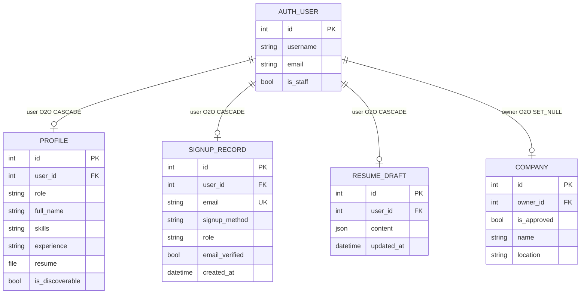
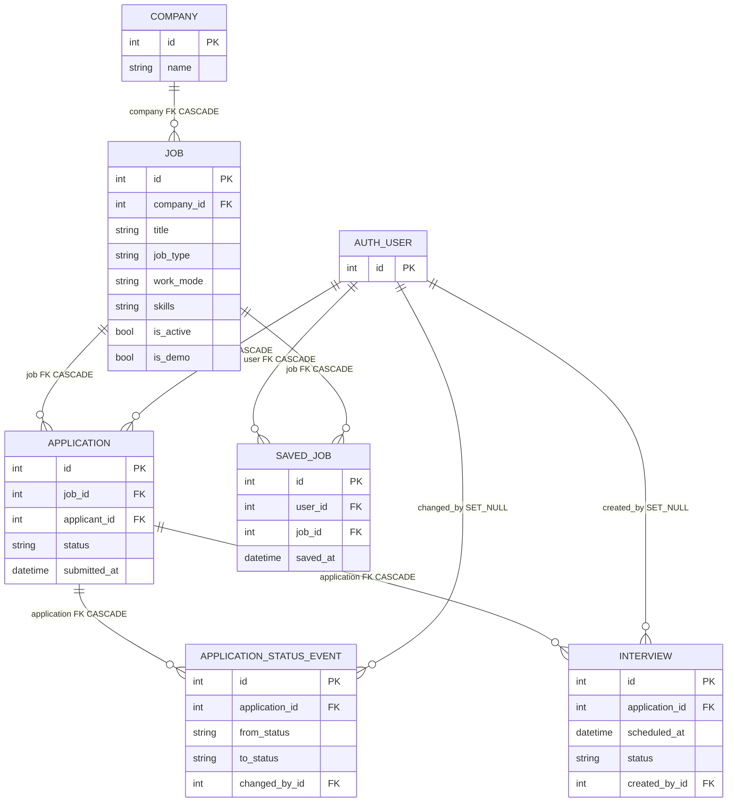
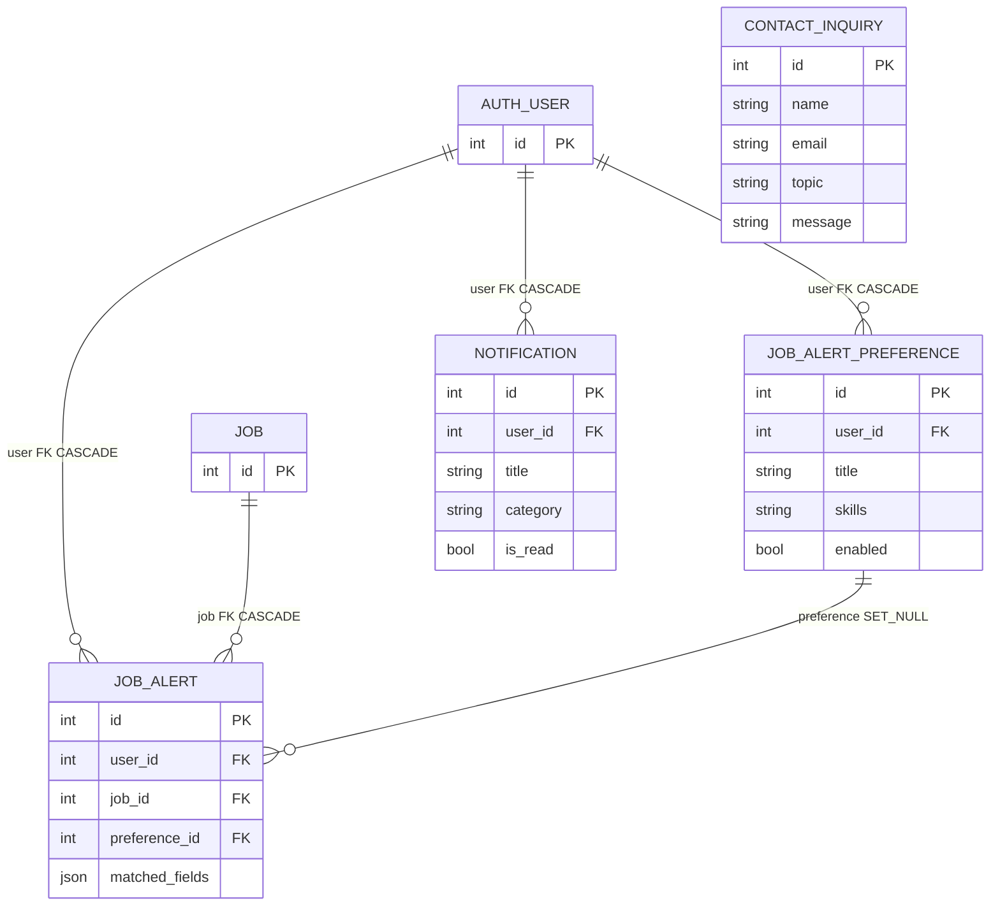

# TalentBridgeAI — Day 7 Entity Relationship Diagram (Existing Implementation)

**Date:** 2026-11-18  
**Roadmap day:** Day 7 only  
**Status:** COMPLETE (source + read-only SQLite comparison)  
**Scope:** Existing models only — no redesign, no migrations, no schema changes.

**Supporting evidence:**  
- Source: `backend/legacy-django/jobs/models.py`  
- Inventory JSON: `docs/reports/_day7_model_inventory.json`  
- Prior: Day 3 structure, Day 5 backup/inventory, Day 6 URL map  

---

## 1. Discovery summary

| Item | Value |
| --- | --- |
| Project root | `E:\Job POrtal\TalentBridgeAI` |
| Domain app with custom models | `jobs` (`jobs.apps.JobsConfig`) |
| Models package | Single file `jobs/models.py` (no `models/` package) |
| Custom user model | **No** — uses `django.contrib.auth.models.User` (`AUTH_USER_MODEL` default) |
| Abstract / proxy / unmanaged project models | **None** in `jobs` |
| Concrete `jobs` models | **13** |
| Concrete fields on `jobs` models | **103** (includes implicit `id` PKs) |
| Declared relationships (FK/O2O) | **18** (no `ManyToManyField` in project models) |
| Model↔DB table mismatches (`jobs_*`) | **None** (read-only PRAGMA compare) |

**Third-party / framework tables** (present in DB; not project-authored models): `auth_*`, `django_*`, `account_*`, `socialaccount_*`. Documented in Day 5; shown only as identity/social context below.

**Domains that do NOT exist as models** (investigation only): Education, Experience (structured), Skill, CandidateSkill, JobSkill, JobCategory, Location entity, CompanyMember, Recruiter, AuditLog, NotificationPreference, ProfileVisibility entity.

---

## 2. Concrete model → app → table mapping

| # | Model | App | Table | Type |
| --- | --- | --- | --- | --- |
| 1 | `Company` | jobs | `jobs_company` | Concrete |
| 2 | `Job` | jobs | `jobs_job` | Concrete |
| 3 | `Profile` | jobs | `jobs_profile` | Concrete |
| 4 | `SignupRecord` | jobs | `jobs_signuprecord` | Concrete |
| 5 | `ResumeDraft` | jobs | `jobs_resumedraft` | Concrete |
| 6 | `Application` | jobs | `jobs_application` | Concrete |
| 7 | `ApplicationStatusEvent` | jobs | `jobs_applicationstatusevent` | Concrete |
| 8 | `ContactInquiry` | jobs | `jobs_contactinquiry` | Concrete |
| 9 | `SavedJob` | jobs | `jobs_savedjob` | Concrete |
| 10 | `Notification` | jobs | `jobs_notification` | Concrete |
| 11 | `JobAlertPreference` | jobs | `jobs_jobalertpreference` | Concrete |
| 12 | `JobAlert` | jobs | `jobs_jobalert` | Concrete |
| 13 | `Interview` | jobs | `jobs_interview` | Concrete |
| — | `User` (Django) | auth | `auth_user` | Framework (hub) |

---

## 3. Relationship inventory (confirmed)

| Source | Field | Target | Type | Cardinality | on_delete | null | related_name |
| --- | --- | --- | --- | --- | --- | --- | --- |
| Company | owner | User | O2O | User 0..1 ↔ Company 0..1 | SET_NULL | yes | `owned_company` |
| Job | company | Company | FK | Company 1 → Job * | CASCADE | no | `jobs` |
| Profile | user | User | O2O | User 1 ↔ Profile 1 | CASCADE | no | default `profile` |
| SignupRecord | user | User | O2O | User 1 ↔ SignupRecord 1 | CASCADE | no | `signup_record` |
| ResumeDraft | user | User | O2O | User 1 ↔ ResumeDraft 1 | CASCADE | no | `resume_draft` |
| Application | job | Job | FK | Job 1 → Application * | CASCADE | no | `applications` |
| Application | applicant | User | FK | User 1 → Application * | CASCADE | no | `job_applications` |
| ApplicationStatusEvent | application | Application | FK | Application 1 → Event * | CASCADE | no | `status_events` |
| ApplicationStatusEvent | changed_by | User | FK | User 0..1 → Event * | SET_NULL | yes | `application_status_events` |
| SavedJob | user | User | FK | User 1 → SavedJob * | CASCADE | no | `saved_jobs` |
| SavedJob | job | Job | FK | Job 1 → SavedJob * | CASCADE | no | `saved_by` |
| Notification | user | User | FK | User 1 → Notification * | CASCADE | no | `portal_notifications` |
| JobAlertPreference | user | User | FK | User 1 → Preference * | CASCADE | no | `job_alert_preferences` |
| JobAlert | user | User | FK | User 1 → Alert * | CASCADE | no | `job_alerts` |
| JobAlert | job | Job | FK | Job 1 → Alert * | CASCADE | no | `alerts` |
| JobAlert | preference | JobAlertPreference | FK | Preference 0..1 → Alert * | SET_NULL | yes | `matches` |
| Interview | application | Application | FK | Application 1 → Interview * | CASCADE | no | `interviews` |
| Interview | created_by | User | FK | User 0..1 → Interview * | SET_NULL | yes | `created_interviews` |

**Unique constraints (relationship-related):**

- `Application(job, applicant)` → `unique_job_application_per_applicant`  
- `SavedJob(user, job)` → `unique_saved_job_per_user`  
- `JobAlert(user, job)` → `unique_job_alert_per_user`  
- `Interview(application, scheduled_at)` → `unique_interview_slot_per_application`  
- `SignupRecord.email` unique  

**No ManyToMany / through models** in project code.

**Application-level associations (not FK):**  
- `ResumeDraft.content` JSON may hold education/experience structures used by views/forms — **not** relational.  
- Demo jobs (`Job.is_demo`) filtered in views — flag, not a separate entity.  
- ContactInquiry is standalone (no User FK).

---

## 4. High-level architecture overview

```text
auth.User (identity hub)
 ├── Profile (role: job_seeker | employer)
 ├── SignupRecord (signup audit)
 ├── ResumeDraft (JSON editor cache)
 ├── Company (optional O2O owner; employer)
 │    └── Job *
 │         ├── Application * ── StatusEvent * ; Interview *
 │         ├── SavedJob *
 │         └── JobAlert *
 ├── JobAlertPreference *
 └── Notification *

ContactInquiry (orphan contact form rows)
```

---

## 5. Domain ERDs (Mermaid)

### 5.1 Identity, profile, signup, resume draft



### 5.2 Jobs, applications, interviews, saved jobs



### 5.3 Alerts, notifications, contact



---

## 6. Uncertain / non-database associations

| Item | Status |
| --- | --- |
| Education/Experience rows inside `ResumeDraft.content` | **Application-level JSON** — not ER edges |
| Comma-separated `skills` strings linking Profile↔Job | **No FK** — search via string match |
| allauth `SocialAccount` ↔ User | Third-party; confirmed by allauth schema, not `jobs.models` |
| Demo job listings without DB rows | View/demo fallback — not a model |

---

## 7. Potential schema inconsistencies (observations only)

| ID | Observation | Evidence |
| --- | --- | --- |
| S1 | `Company.owner` SET_NULL can leave companies without owners while jobs remain | `models.py` O2O + Job CASCADE from Company |
| S2 | Dual application status vocabularies (`applied`… + legacy `pending`/`reviewed`) | `Application.STATUS_CHOICES` |
| S3 | No Meta `indexes` beyond UniqueConstraints / FK indexes | Model Meta blocks |
| S4 | `ApplicationStatusEvent` + `ResumeDraft` not registered in admin | Admin registry vs models |
| S5 | `Profile.user` uses bare `User` import; others use `AUTH_USER_MODEL` | Style inconsistency; same default user |
| S6 | Models match SQLite `jobs_*` tables with **no column discrepancies** | Day 7 PRAGMA compare |

---

## 8. Usage anchors (from Day 6 / code)

| Model | Primary usage |
| --- | --- |
| Profile / Company / Job | Signup, dashboards, job list/detail, employer flows |
| Application / StatusEvent / Interview | Apply, manage applications, interviews |
| SavedJob / JobAlert* / Notification | Saved jobs, alerts, in-app notifications |
| ResumeDraft / Profile.resume | Resume builder + file download |
| SignupRecord | Signup/Google audit |
| ContactInquiry | Contact form |

---

## 9. Mermaid validation

Diagrams use standard `erDiagram` syntax with quoted relationship labels and entity attribute blocks.  
**Validation method:** Manual syntax review against Mermaid ER rules (no `mermaid-cli` package installed; Day 7 forbids installing packages).  
**Result:** **PASS (manual)** — three diagrams; no invented entities.

---

## Day 7 ERD completion

All **13** concrete `jobs` models and the **User** hub are represented. No schema modifications performed.
